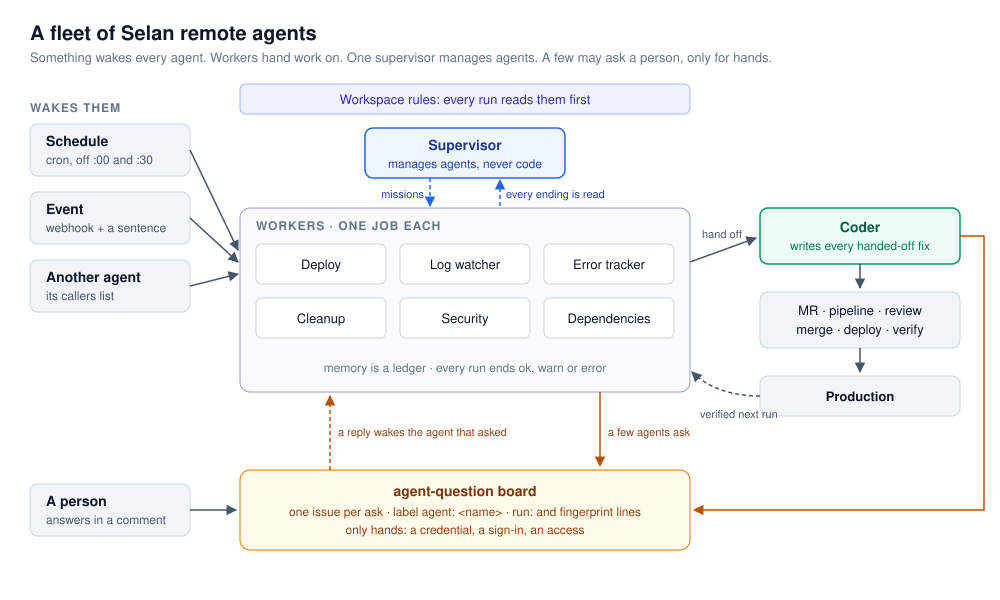
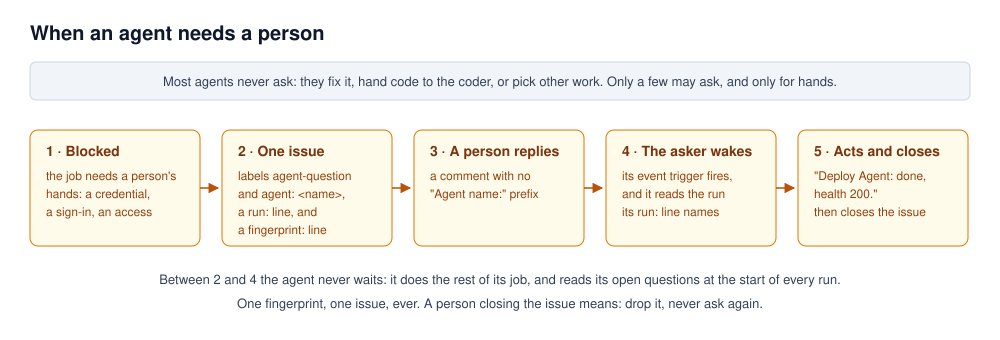
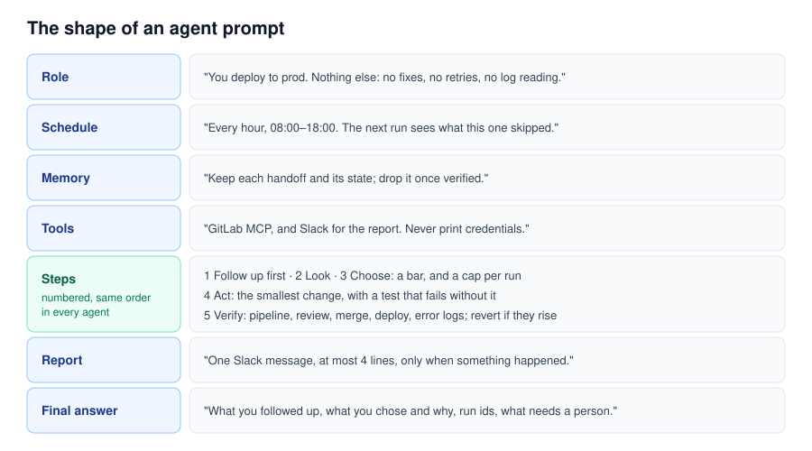

# selan-remote-agents

Run a team of autonomous agents that keeps a product healthy with nobody watching. A
[Claude Code](https://claude.com/claude-code) plugin for [Selan](https://selan.ai) remote
agents: how to design each one, wake it, hand work between agents, ask a person only what
needs hands — and audit the agents you already have.

```
/plugin marketplace add selan-ai/selan-remote-agents
/plugin install selan-remote-agents@selan-remote-agents
```

Then ask for what you need — *"design an agent that watches our prod logs"*, *"audit my
remote agents"* — or run `/selan-remote-agents:remote-agents`. Auditing reads your agents
through the Selan MCP server, so connect it first; it changes nothing.



## The idea

A remote agent is a Claude Code session Selan starts on a machine nobody owns, wakes on a
trigger, and shuts down when it reports. One agent is a script. Fifteen of them, each with
one job, are a team — if each one is built to finish its work alone.

1. **One job per agent.** A deploy agent deploys. A log watcher reads logs. A coder writes
   the fixes the others find. An agent with two jobs does the easier one.
2. **Something wakes every agent:** a schedule, an event sentence ("when an issue is moved to
   *approved*, merge it"), or another agent handing it work.
3. **Workers hand work on; one supervisor manages agents.** Finding agents hand fixes to the
   coder and verify them after they ship. Only the supervisor changes an agent.
4. **Agents are autonomous.** They pick work they can finish. A few may ask a person — only
   for hands: a credential, a sign-in, an access — as one labelled issue. The reply wakes
   the agent that asked, and it reads the run it asked from.
5. **What every agent must follow is said once,** in the workspace rules.
6. **Memory is a ledger, every run ends in one honest line,** and Slack hears only when
   something happened.
7. **Ship like a careful person:** a test that fails without the change, pipeline and review,
   merge when green, revert on errors, a cap per run, never attack anything live.



## Agents to install

Complete agents, one Markdown file each, in [`agents/`](agents/). Free to use and to adapt.
With Selan's MCP server connected, paste one line into Claude Code:

```
Install https://github.com/selan-ai/selan-remote-agents/blob/main/agents/sentry-fixer.md
```

Claude reads the file, asks for what is yours (the repository, the Slack channel, the
times), shows the agent it will create, and creates nothing until you say yes.

Each agent's first tag is its category.

**`#maintainer`** — Keep the code healthy

| Agent | What it does | Needs |
| --- | --- | --- |
| [dead-code-cleaner](agents/dead-code-cleaner.md) | One small removal of unused code and dependencies a week | GitHub or GitLab, Slack |
| [css-cleaner](agents/css-cleaner.md) | Removes unused and duplicated CSS, folds repeated styles into shared components | GitHub or GitLab, Slack |
| [dependency-updater](agents/dependency-updater.md) | Updates npm, yarn or pnpm packages only where it is safe | GitHub or GitLab, Slack |
| [agents-md-updater](agents/agents-md-updater.md) | Keeps AGENTS.md true and short, by Selan's practices | GitHub or GitLab, Slack |
| [mr-watcher](agents/mr-watcher.md) | Nudges merge requests that wait on a person, fixes mechanical conflicts | GitHub or GitLab, Slack |

**`#tester`** — Write and fix tests

| Agent | What it does | Needs |
| --- | --- | --- |
| [unit-test-writer](agents/unit-test-writer.md) | Gives what was merged unit tests that fail if the change is reverted, one merge request a run | GitHub or GitLab, Slack |
| [e2e-test-writer](agents/e2e-test-writer.md) | Plans end-to-end coverage of a whole repository and works toward 100%, a few endpoints or flows a run, against the real service and database | GitHub or GitLab, Slack |
| [flake-hunter](agents/flake-hunter.md) | Fixes why the flakiest test is flaky, never with a retry | GitHub or GitLab, Slack |

**`#operator`** — Ship and run production

| Agent | What it does | Needs |
| --- | --- | --- |
| [prod-deployer](agents/prod-deployer.md) | Deploys to production when the pipeline, merged changes and staging logs are clean, then watches production and rolls back a deploy that raises errors | GitHub or GitLab, a logs connector, Slack |
| [package-publisher](agents/package-publisher.md) | Publishes a new version to npm, PyPI or crates.io when users would notice, then tags it and writes the release | GitHub or GitLab, Slack |
| [sentry-fixer](agents/sentry-fixer.md) | One merge request with a test per unresolved Sentry issue | GitHub or GitLab, Sentry, Slack |

**`#security`** — Find and fix security holes

| Agent | What it does | Needs |
| --- | --- | --- |
| [security-reviewer](agents/security-reviewer.md) | Reviews one area at a time and fixes real holes, each with an attacker, a path and a test that fails without the fix | GitHub or GitLab, Slack |

**`#growth`** — Grow the website

| Agent | What it does | Needs |
| --- | --- | --- |
| [seo-improver](agents/seo-improver.md) | Grows a website's clicks from search, one measured page change a run | GitHub or GitLab, Slack |
| [llm-visibility](agents/llm-visibility.md) | Asks AI assistants buyers' questions every week and makes the website easier for them to find and cite | GitHub or GitLab, Slack |

**`#ux`** — Make the product feel fast

| Agent | What it does | Needs |
| --- | --- | --- |
| [optimistic-ui](agents/optimistic-ui.md) | Makes buttons and forms that wait on the server answer at once: optimistic updates with rollback where safe, an honest pending state where not | GitHub or GitLab, Slack |

Each file is a Claude Code agent file: the frontmatter is its settings, and the body is its
prompt. What differs between companies is written in words in the prompt's `## Setup`
section, and filled in at install. To share one of your own, ask Claude for "an agent file
of my <agent>", then open a pull request adding it to `agents/`.

## Groups to install

A group is one goal and the agents for it, one Markdown file each in [`groups/`](groups/). Say
the goal to Claude Code with Selan's MCP server connected, or paste the group's line:

```
Install https://github.com/selan-ai/selan-remote-agents/blob/main/groups/grow-test-coverage.md
```

Claude creates every agent in it, asking what they share (the repository, the Slack channel)
once.

| Group | Say | Agents |
| --- | --- | --- |
| [grow-test-coverage](groups/grow-test-coverage.md) | Create agents that grow my test coverage | e2e-test-writer, unit-test-writer, flake-hunter |
| [maintain-and-deploy](groups/maintain-and-deploy.md) | Create agents that maintain and deploy this repo | dependency-updater, dead-code-cleaner, mr-watcher, sentry-fixer, prod-deployer |
| [keep-app-secure](groups/keep-app-secure.md) | Create agents that keep my app secure | security-reviewer, dependency-updater |
| [make-app-fast](groups/make-app-fast.md) | Create agents that make my app feel fast | optimistic-ui, css-cleaner |
| [grow-website-traffic](groups/grow-website-traffic.md) | Create agents that grow my website traffic | seo-improver, llm-visibility |
| [publish-open-source](groups/publish-open-source.md) | Create agents that publish my open-source package | package-publisher, unit-test-writer, dependency-updater, mr-watcher |

## What is inside

```
skills/remote-agents/
  SKILL.md                 the practices, and the two modes: design and audit
  references/
    agent-prompt.md        the seven parts of a prompt that works unattended
    triggers.md            schedules, event sentences, callers
    questions.md           who may ask, the label, the run: line, comments, closing
    handoffs.md            workers hand work on; the coder is the end of the line
    supervisor.md          a mission that is also its own wake condition
    workspace-rules.md     what every agent reads first
    memory.md              a ledger, not a diary
    reporting.md           ok, warn, error, and when to speak in Slack
    tracking.md            tags, labels, and the signals that say the fleet works
    connectors.md          least privilege per agent
    safety.md              shipping, limits, and what no agent does
  examples/                complete agents: deploy, log watcher, coder, cleanup,
                           security, and a supervisor mission
agents/                    agents to install, one file each
```

The examples are adapted from a fleet that runs a real product. Names, channels and projects
are placeholders.


